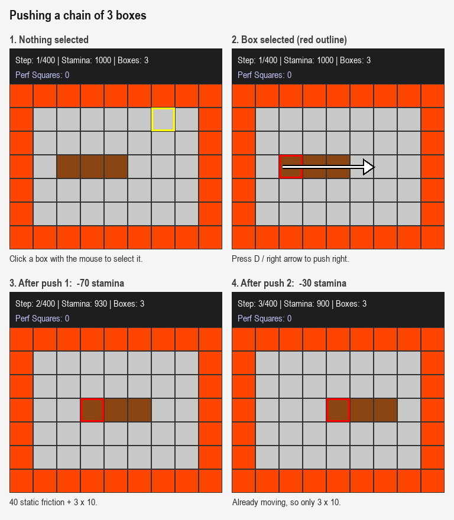
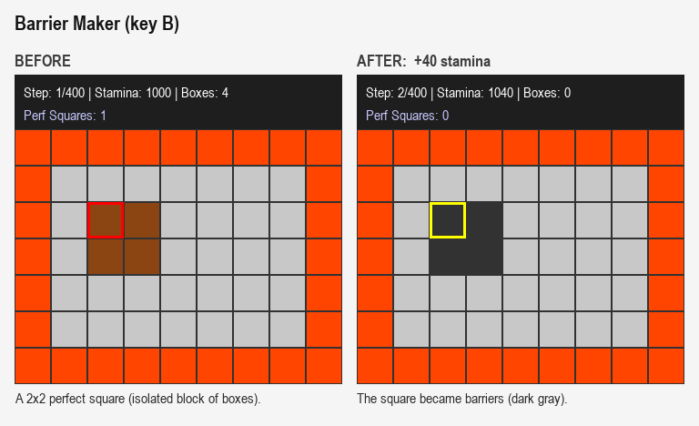
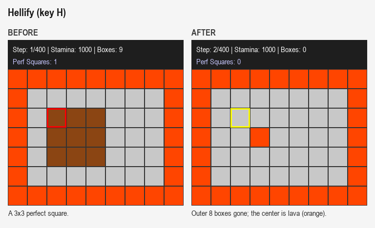

# Shover World 📦🔥

**Shover World** is a custom Reinforcement Learning environment built on [Gymnasium](https://farama.org/Gymnasium) and rendered with [Pygame](https://www.pygame.org/).

It’s a grid-world puzzle where an agent (the “Shover”) moves, pushes chains of boxes, and manages a limited **Stamina** resource. The environment implements inertia-based push costs, detection of **Perfect Squares** of boxes and special abilities that alter the map.

Created by **Parsa Akhbar** as a project for the Artificial Intelligence course (A.I. 2025), taught by **Dr. Katanforoush**.

---

## 📸 Screenshots

Each image shows the real game board before and after an action, rendered by the game itself. Brown = box, dark gray = barrier, orange = lava (the border is lava too), light gray = empty. The outlined cell is the selected target.







Regenerate the images with `python docs/make_screenshots.py`.

---

## 📂 Project Structure

```
shover-world/
│
├── environment.py       # Core Gymnasium logic (physics, rules, states)
├── gui.py               # Pygame rendering & input handling
├── human_test.py        # Script for manual play (keyboard/mouse)
├── agent_test.py        # Script for random agent play (headless/GUI)
├── test.py              # Headless smoke test (one random episode)
├── maps/                # Folder containing map .txt files
│   ├── custom_map.txt
│   ├── map_small.txt    # Integer-grid format
│   ├── agent_small.txt  # Symbolic format with agent start
│   └── map_generator.py # Utility to generate procedural maps
├── tests/               # Unit tests (pytest)
│   ├── conftest.py
│   ├── test_push.py
│   ├── test_stamina.py
│   ├── test_squares.py
│   └── test_maps.py
├── docs/                # Screenshots + script that regenerates them
├── requirements.txt
├── pytest.ini
└── README.md            # This file
```

---

## 🛠 Installation

Require: **Python 3.8+**

Install dependencies:

```bash
pip install -r requirements.txt
```

---

## 🚀 How to Run

### 1. Manual Play (Human Mode)

```bash
python human_test.py
```

**Controls**

* **Mouse Click:** Select a target cell (Red = Box, Yellow = Empty)
* **W / ↑ :** Push Up / move cursor
* **D / → :** Push Right / move cursor
* **S / ↓ :** Push Down / move cursor
* **A / ← :** Push Left / move cursor
* **B:** Barrier Maker (requires an isolated 2×2 box square)
* **H:** Hellify (requires an isolated 3×3 box square)
* **R:** Reset level
* **Q:** Quit

---

### 2. Random Agent

```bash
# With graphics
python agent_test.py

# Headless (no graphics)
python agent_test.py --headless
```

---

### 3. Generate New Maps

```bash
# Interactive generator
python maps/map_generator.py

# Command-line options
python maps/map_generator.py --filename level1.txt --rows 15 --cols 15 --boxes 40
```

---

### 4. Smoke Test

```bash
python test.py
```

### 5. Run Unit Tests

```bash
pytest
```

---

## ⚙️ Parameters (`ShoverWorldEnv`)

| Name | Default | Meaning |
| ---- | ------- | ------- |
| `render_mode` | `'human'` | `'human'` opens the Pygame window; `None` runs headless |
| `n_rows`, `n_cols` | `13`, `9` | Playable grid size (a Lava border is added around it) |
| `max_timestep` | `400` | Steps before the episode is truncated |
| `number_of_boxes` | `15` | Boxes in randomly generated maps |
| `number_of_barriers` | `5` | Barriers in randomly generated maps |
| `number_of_lavas` | `3` | Internal lava cells in randomly generated maps |
| `initial_stamina` | `1000.0` | Starting stamina |
| `initial_force` | `40.0` | One-time push cost when the head box is stationary; also the lava refund |
| `unit_force` | `10.0` | Push cost per box in the chain; Barrier Maker pays `unit_force * N²` |
| `perf_sq_initial_age` | `10` | Steps an untouched perfect square survives before dissolving |
| `map_path` | `None` | Map file to load; falls back to the generator if missing or malformed |
| `seed` | `None` | RNG seed |

## 🧠 Design Notes

**Stationary logic.** The simpler variant allowed by the spec is implemented: a push pays `initial_force` if and only if the *front-most box of the chain* did not move in that same direction on the immediately preceding step. Each step records the direction every moved box travelled; any step in which a box does not move (a no-op, an invalid action, or a push in another direction) makes it stationary again. So pushing right twice in a row pays `initial_force` once, while right, no-op, right pays it twice.

**Push cost.** `cost = unit_force * k + (initial_force if stationary else 0)`, where `k` is the chain length. A box pushed into Lava is destroyed and refunds `initial_force`.

**Invalid actions** (selecting a non-box cell, a blocked chain, an unavailable special action) change nothing and cost no stamina. There is no per-step baseline cost.

**Barrier Maker reward** follows the default in the spec's parameter reference (`+10 × n²`, i.e. `unit_force * n²`).

---

## 🎮 Game Mechanics

### Stamina System ⚡

* Agent starts with **1000** Stamina.
* Episode ends if **Stamina ≤ 0** or **Time Step >= Max Time Step**.

**Push Costs**

* **Kinetic friction:** `-10` stamina per box in the chain.
* **Static friction:** additional `-40` if the chain was stationary (not moving in that direction) previous step.
* **Lava refund:** pushing a box into Lava (`L`) removes the box and refunds `+40` stamina.
* **Barrier bonus:** using Barrier Maker grants `unit_force * N²` stamina (default `10 * N²`) (for an N×N square converted to barriers).

Keep chains moving to save energy.

---

### Perfect Squares & Abilities ✨

* **Perfect Square:** an **N×N** block of boxes (N ≥ 2) that is isolated (no other boxes touching its outer border).
* A perfect square left untouched for **10 steps** dissolves into empty space.

**Abilities**

* **Barrier Maker (Action 5):** Converts an isolated N×N square (N ≥ 2) into Barriers (`#`) and grants stamina.
* **Hellify (Action 6):** Converts an isolated N×N square (N > 2) into a hollow Lava (pit) structure.

---

## 🤖 RL Specification

### Observation Space (Dict)

* `grid` — `Box(int)`: map grid values (`-100`: Lava, `0`: Empty, `10`: Box, `100`: Barrier)
* `agent` — `Box(int)`: `[row, col]` cursor/selection position
* `previous_selected_position` — `Box(int)`: `[row, col]` of the previously selected cell
* `stamina` — `Box(float)`: current stamina value
* `previous_action` — `Discrete`: last action taken

### Action Space

Agent provides a tuple: **(Target_Coordinate, Action_Type)**

* `Target_Coordinate`: `[row, col]` — where to focus/push
* `Action_Type`: `Discrete(7)`

| ID | Action        |
| -- | ------------- |
| 0  | No-Op         |
| 1  | Push Up       |
| 2  | Push Right    |
| 3  | Push Down     |
| 4  | Push Left     |
| 5  | Barrier Maker |
| 6  | Hellify       |

### Rewards & Termination

* **Rewards:** currently `0` — environment is survival/resource-management focused.
* **Terminated if:**

  * `stamina ≤ 0`
  * All boxes are destroyed
* **Truncated if:**

  * `timestep >= max_timestep` (default `400`)

---

## 🗺 Map Encoding

Maps are plain `.txt` files in `maps/`, with **space-separated** symbols (see `maps/custom_map.txt`). The environment adds a Lava border automatically.

| Symbol | Meaning         | Internal Value |
| ------ | --------------- | -------------- |
| `.`    | Empty           | `0`            |
| `B`    | Box             | `10`           |
| `#`    | Barrier         | `100`          |
| `L`    | Lava            | `-100`         |
| `A`    | Agent start pos | `None`         |

---

## Notes

* Tests live in `tests/` and use `pytest` (run from the repo root).
* The environment is designed for easy agent integration (DQN/PPO/etc.).

## License

MIT — see [LICENSE](LICENSE).
